<p align="center">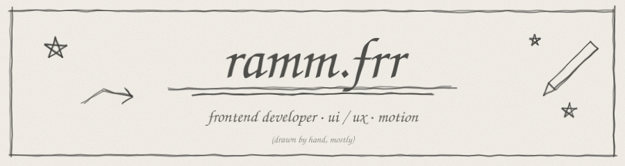</p>

<p align="center"><a href="https://ramfr.vercel.app">portfolio</a> · <a href="https://github.com/ram-ft">github</a> · <a href="https://dribbble.com/Sayzz">dribbble</a> · <a href="https://www.instagram.com/ramm.frr/">instagram</a> · <a href="mailto:itsram.ft@gmail.com">email</a></p>

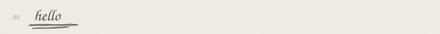

A frontend developer obsessed with the intersection of **design and code**. I build web experiences that feel as good as they look: clean layouts, silky motion, pixel-perfect details.

I believe the best interfaces are the ones that get out of the way. No noise, no clutter. Just the thing that matters, delivered beautifully.

When I'm not pushing pixels, I'm exploring typography, listening to ambient music, or getting deep into a new UI rabbit hole.

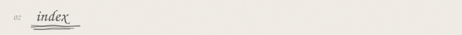

<sub>`01` hello · `02` index · `03` focus · `04` skills · `05` stack · `06` tools · `07` projects · `08` typestack · `09` ellie · `10` napkin · `11` sona · `12` now · `13` learning · `14` philosophy · `15` principles · `16` palette · `17` typography · `18` spacing · `19` grid · `20` motion · `21` easing · `22` workflow · `23` process · `24` sketching first · `25` design systems · `26` tokens · `27` component checklist · `28` states · `29` accessibility · `30` performance · `31` images · `32` fonts · `33` code style · `34` naming · `35` git · `36` commits · `37` structure · `38` snippet · `39` css · `40` setup · `41` shortcuts · `42` inspiration · `43` resources · `44` reading · `45` music · `46` rabbit holes · `47` fun facts · `48` faq · `49` services · `50` availability · `51` collaboration · `52` feedback · `53` roadmap · `54` goals · `55` habits · `56` rhythm · `57` tips · `58` ui rules · `59` empty states · `60` microcopy · `61` forms · `62` buttons · `63` colour usage · `64` dark mode · `65` responsive · `66` breakpoints · `67` testing · `68` deploy · `69` learning method · `70` values · `71` anti-goals · `72` lessons · `73` mistakes · `74` ask me about · `75` work with me · `76` contact · `77` colophon</sub>

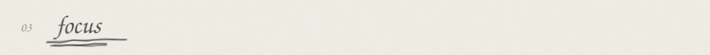

| | |
|:--|:--|
| primary | interfaces & interaction |
| secondary | motion & micro-interactions |
| tertiary | design systems |
| always | performance & accessibility |

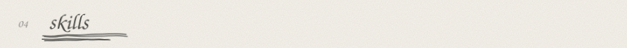

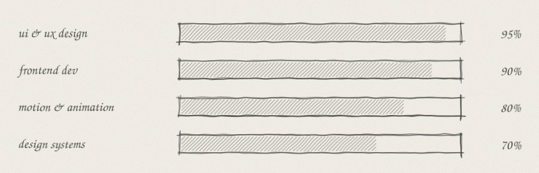

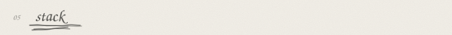

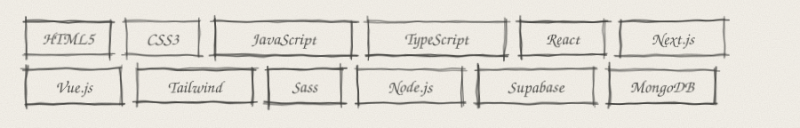

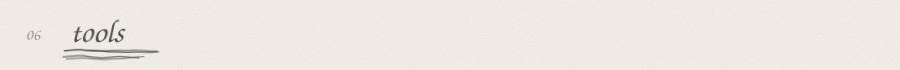

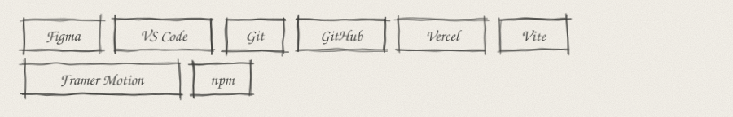

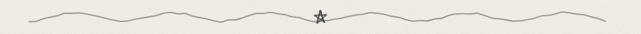

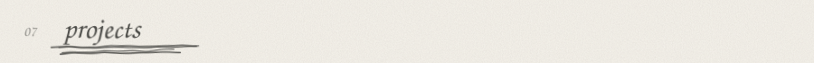

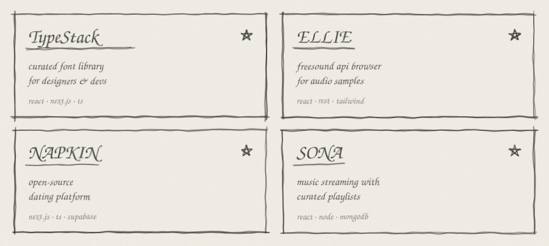

[TypeStack](https://typestack.vercel.app) · [ELLIE](https://ellie0.vercel.app) · [NAPKIN](https://napkin0.vercel.app) · [SONA](https://sona0.vercel.app)

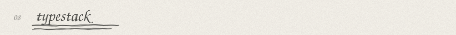

curated font library for designers & devs. [typestack.vercel.app](https://typestack.vercel.app)

*react · next.js · typescript*. Built around discovery, previews and calm browsing of typefaces.

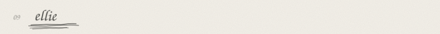

freesound api browser for audio samples. [ellie0.vercel.app](https://ellie0.vercel.app)

*react · rest · tailwind*. Search, preview and collect sounds without friction.

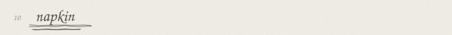

open-source dating platform. [napkin0.vercel.app](https://napkin0.vercel.app)

*next.js · typescript · supabase*. A simple, open take on meeting people.

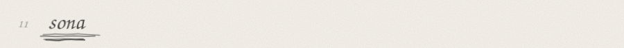

music streaming with curated playlists. [sona0.vercel.app](https://sona0.vercel.app)

*react · node · mongodb*. Playlists, playback and a quiet listening experience.

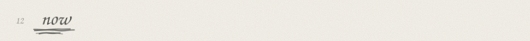

- polishing my portfolio
- shipping small ui experiments
- building smoother micro-interactions

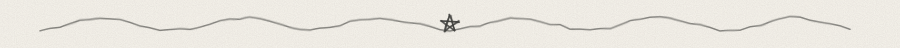

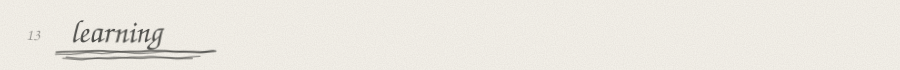

`webgl` &nbsp; `three.js` &nbsp; `gsap` &nbsp; `shaders`

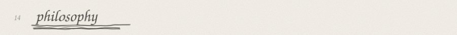

> less noise. more signal.
>
> details are the design.
>
> motion should explain, not decorate.

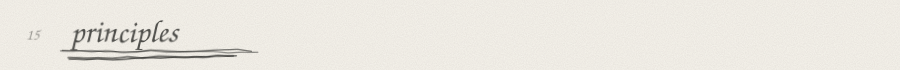

1. **clarity first.** one primary action per screen
2. **whitespace is a feature.** let content breathe
3. **consistent rhythm.** a 4 / 8px spacing scale
4. **fast by default.** lean bundles, lazy assets
5. **accessible always.** contrast, focus, semantics

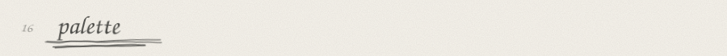

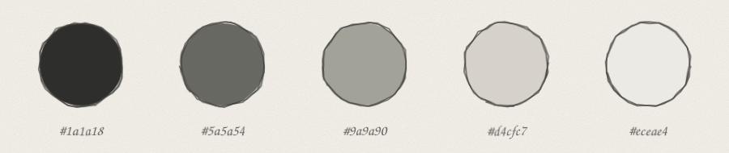

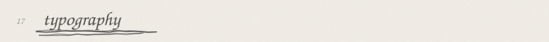

| role | face |
|:--|:--|
| interface | Inter |
| display | Playfair Display |
| technical | Fira Code |
| experimental | Space Grotesk |

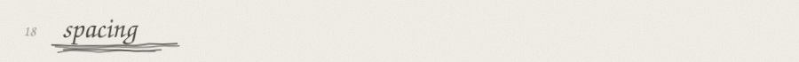

```
4   8   12   16   24   32   48   64   96
```
everything snaps to this scale. no magic numbers.

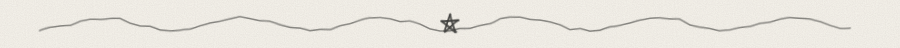

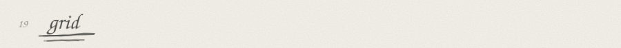

- 12 columns on desktop, 4 on mobile
- consistent gutters, generous margins
- align to the grid, break it on purpose

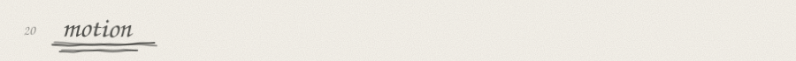

```
150-300ms   micro ui       hover · press · toggle
300-500ms   layout change  modal · panel · drawer
500ms+      storytelling   page · scroll · hero
```

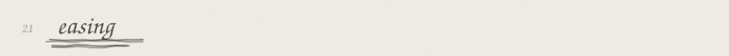

```
ease-out      entrances    decelerate into place
ease-in       exits        accelerate away
ease-in-out   movement     A to B on screen
linear        loops        progress · spinners
```

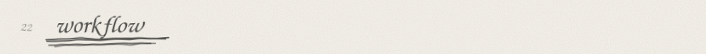

```
idea  ->  sketch  ->  figma  ->  code  ->  motion  ->  ship
  ^                                                      |
  '------------------ feedback --------------------------'
```

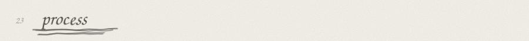

1. **discover.** goals, users, constraints
2. **design.** wireframes to hi-fi
3. **build.** clean, componentised code
4. **polish.** motion, a11y, performance
5. **ship.** deploy, measure, iterate

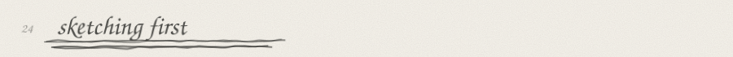

before the editor, a pencil. thumbnails first, then flows, then details. cheap to erase, expensive to rebuild.

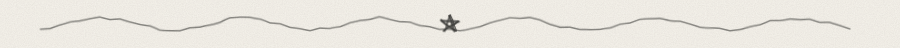

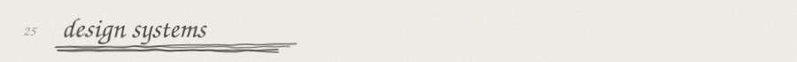

- start from tokens: colour, type, spacing, radius, shadow
- build primitives before patterns
- document variants and states
- keep the api small and predictable

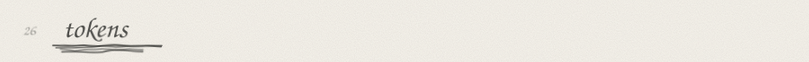

```css
:root {
  --ink: #1a1a18;
  --muted: #5a5a54;
  --paper: #eceae4;
  --radius: 8px;
  --ease: cubic-bezier(0.22, 1, 0.36, 1);
}
```

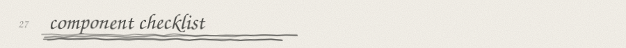

- [ ] default, hover, focus, active, disabled
- [ ] loading and empty states
- [ ] error state with clear copy
- [ ] responsive from 320px up
- [ ] keyboard and screen-reader friendly

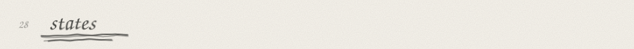

every element has more than one face: **rest, hover, focus, pressed, disabled, loading, error, success.** design all of them.

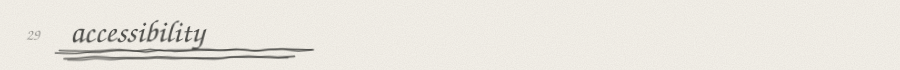

- semantic html before aria
- visible focus states, always
- contrast of at least 4.5:1 for body text
- respect `prefers-reduced-motion`
- never rely on colour alone

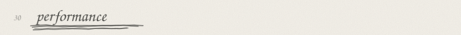

- ship less javascript
- lazy-load below the fold
- animate `transform` and `opacity`
- measure before optimising

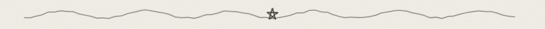

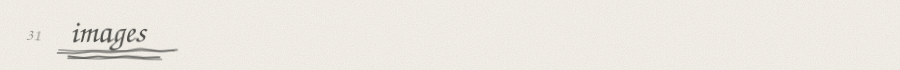

right format, right size, right moment. `webp` / `avif`, responsive `srcset`, explicit width and height to avoid layout shift.

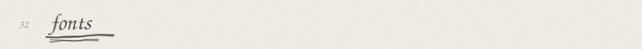

subset, preload the critical weight, `font-display: swap`. fewer weights, better pages.

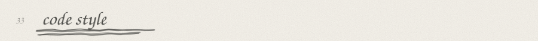

- small components, single responsibility
- types over comments
- early returns over nesting
- delete code that isn't earning its place

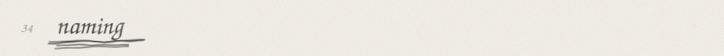

| do | don't |
|:--|:--|
| `isOpen` | `flag1` |
| `handleSubmit` | `doStuff` |
| `UserCard` | `Card2` |

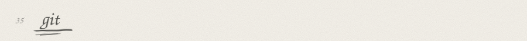

- small, focused branches
- review your own diff first
- never commit secrets

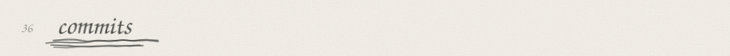

```
feat:      a new feature
fix:       a bug fix
style:     visual change
refactor:  no behaviour change
docs:      documentation only
chore:     tooling and housekeeping
```

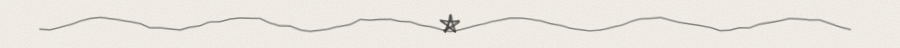

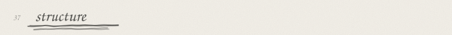

```
src/
├── app/
├── components/
│   ├── ui/
│   └── sections/
├── hooks/
├── lib/
├── styles/
└── types/
```

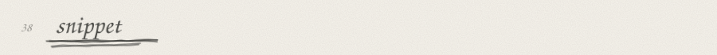

```typescript
const ramm = {
  role: "Frontend Developer",
  focus: ["UI/UX", "Motion", "Design Systems"],
  stack: ["React", "Next.js", "TypeScript", "Tailwind"],
  loves: ["typography", "ambient music", "clean layouts"],
  hireable: true,
} as const;
```


```css
@media (prefers-reduced-motion: reduce) {
  * { animation: none !important; transition: none !important; }
}
```


| | |
|:--|:--|
| editor | VS Code |
| browser | Chrome |
| design | Figma |
| deploy | Vercel |


<kbd>Ctrl</kbd> + <kbd>P</kbd> &nbsp; <kbd>Ctrl</kbd> + <kbd>D</kbd> &nbsp; <kbd>Alt</kbd> + <kbd>↑</kbd> &nbsp; <kbd>Ctrl</kbd> + <kbd>`</kbd>


[Awwwards](https://www.awwwards.com) · [Dribbble](https://dribbble.com) · [Behance](https://www.behance.net) · [Mobbin](https://mobbin.com) · [Godly](https://godly.website)


- [MDN Web Docs](https://developer.mozilla.org)
- [web.dev](https://web.dev)
- [CSS-Tricks](https://css-tricks.com)
- [Refactoring UI](https://www.refactoringui.com)


- *Refactoring UI*
- *The Design of Everyday Things*
- *Thinking with Type*


ambient · lo-fi · instrumental


```
[████████░░]  css scroll-driven animations
[██████░░░░]  variable fonts
[████░░░░░░]  shader effects
[██░░░░░░░░]  creative coding
```


<details>
<summary>show</summary>
<br/>

- ambient music is the default soundtrack
- will happily spend an hour choosing a typeface
- ui rabbit holes are a hobby, not a bug

</details>


<details>
<summary>what do you specialise in?</summary>
<br/>
frontend development with a design-first mindset: ui/ux, motion and design systems.
</details>

<details>
<summary>are you open to collaborations?</summary>
<br/>
yes. email me at <a href="mailto:itsram.ft@gmail.com">itsram.ft@gmail.com</a>.
</details>

<details>
<summary>where can i see your design work?</summary>
<br/>
on <a href="https://dribbble.com/Sayzz">dribbble</a> and my <a href="https://ramfr.vercel.app">portfolio</a>.
</details>


| design | develop | animate |
|:--|:--|:--|
| ui / ux | landing pages | micro-interactions |
| design systems | web apps | page transitions |
| prototypes | next.js sites | scroll effects |


open to opportunities.


- clear goals, early
- short feedback loops
- honest about trade-offs
- ship, then refine


critique the work, not the person. specific beats vague: *"the hierarchy is unclear"* beats *"it feels off"*.


```
now     polish portfolio · ship ui experiments
next    learn webgl · grow design systems
later   open-source a component library
```


- [x] build a font library
- [x] launch a music app
- [ ] master webgl
- [ ] publish a component library
- [ ] speak at a meetup


- sketch before opening the editor
- ship something small every week
- read one good codebase a month
- keep a swipe file of great ui


```
code        ████████░░░░░░░░  8h
design      ████░░░░░░░░░░░░  4h
learning    ██░░░░░░░░░░░░░░  2h
rabbit hole ███░░░░░░░░░░░░░  3h
sleep       ███████░░░░░░░░░  7h
```


- design the empty state first
- squint test your hierarchy
- if it needs a tooltip, it needs a better label
- make the common path the fast path


- one focal point per view
- limit type sizes to a clear scale
- use colour to signal, not decorate


an empty state is a first impression. say what goes here, why it's empty, and the one thing to do next.


| instead of | write |
|:--|:--|
| submit | save changes |
| error occurred | couldn't save. try again? |
| click here | view the report |


- one column, labels above inputs
- validate inline, explain how to fix
- never clear what the user typed


one primary per view. verbs, not nouns. big enough to tap. a clear pressed state.


neutrals do 90% of the work. one accent for action. status colours only for status.


not an inversion. re-pick the greys, lower the contrast a notch, soften shadows into borders.


start at 320px and grow. content decides breakpoints, not devices.


```
sm  640    md  768    lg  1024    xl  1280
```


components with testing library, flows with playwright, and a keyboard-only pass before every ship.


push, preview, review, promote. every branch gets a preview url on vercel.


1. read the docs
2. build something tiny
3. break it on purpose
4. rebuild it cleaner


**craft** · **simplicity** · **curiosity** · **honesty**


- complexity for its own sake
- animation with no purpose
- dark patterns
- shipping what i wouldn't use


- constraints make better design
- simple scales, clever doesn't
- details are what people remember


over-animating, under-testing, polishing before validating. all made once, mostly learned.


`ui design` &nbsp; `css animation` &nbsp; `react` &nbsp; `next.js` &nbsp; `design systems` &nbsp; `typography`


got an idea, a rough sketch, or a messy ui that needs love? send it over.

[**itsram.ft@gmail.com**](mailto:itsram.ft@gmail.com)


| | |
|:--|:--|
| email | [itsram.ft@gmail.com](mailto:itsram.ft@gmail.com) |
| instagram | [@ramm.frr](https://www.instagram.com/ramm.frr/) |
| dribbble | [Sayzz](https://dribbble.com/Sayzz) |
| github | [ram-ft](https://github.com/ram-ft) |
| portfolio | [ramfr.vercel.app](https://ramfr.vercel.app) |


set in handwriting. coloured in graphite, four greys and one paper tone.


